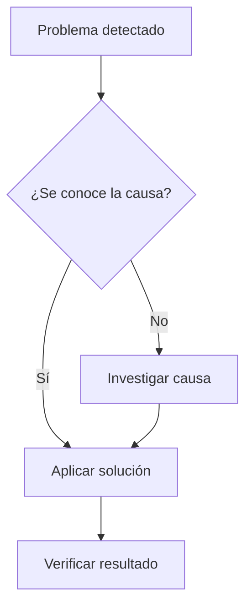
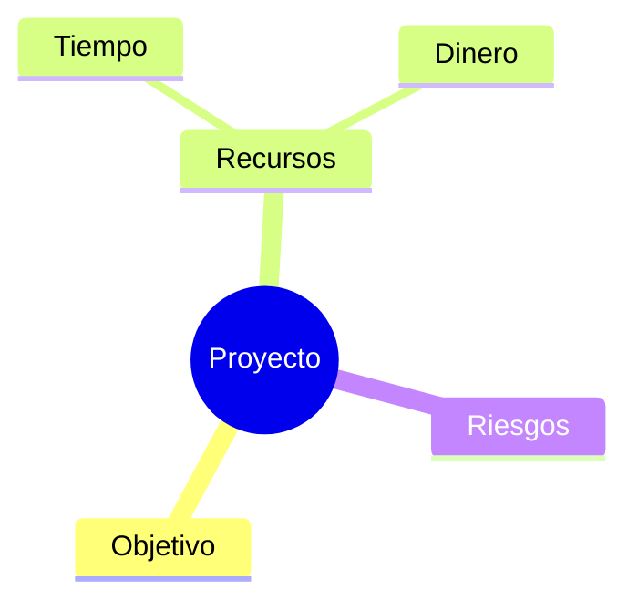
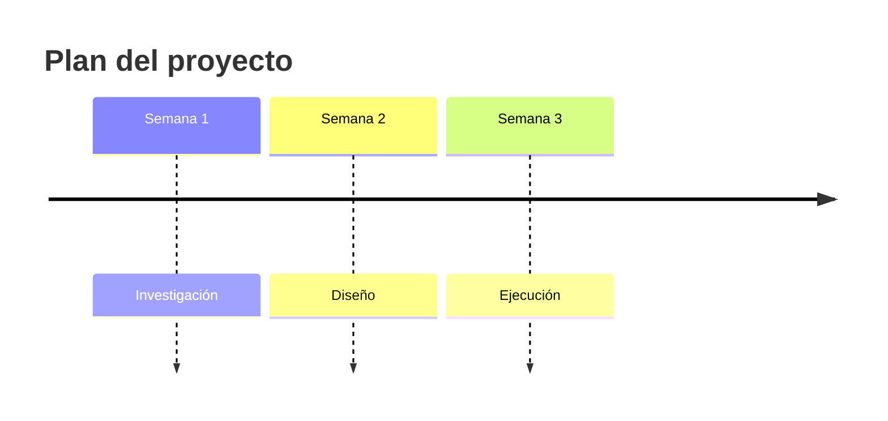

# Cuadros, tablas, esquemas y diagramas

## Elegir el formato correcto

| Lo que se quiere mostrar | Formato |
|---|---|
| Comparar cosas por características | Tabla comparativa |
| Datos con números | Tabla y, si ayuda, un gráfico |
| Un proceso o pasos | Diagrama de flujo |
| Ideas alrededor de un tema | Mapa mental |
| Jerarquía (organización, categorías) | Organigrama o árbol |
| Eventos en el tiempo | Línea de tiempo |
| Un plan con fechas | Diagrama de Gantt o tabla de tareas |

Si no está claro qué formato quiere el usuario, elige el que mejor comunique la idea y menciónalo en una línea.

## Tablas

- Título claro encima de la tabla.
- Máximo 5 columnas para que se lea bien en iPad. Si hacen falta más, divide en dos tablas.
- La primera columna identifica cada fila (nombre, opción, fecha).
- Unidades en el encabezado (por ejemplo "Precio (USD)"), no repetidas en cada celda.
- Debajo, una o dos líneas con la conclusión principal: qué debe notar el usuario.

## Diagramas

Usa **Mermaid** para diagramas, porque se puede ver directamente en Claude y copiar a otras herramientas. Si la app permite crear artefactos visuales, crea el diagrama como artefacto para que se vea renderizado.

Reglas:
- Textos cortos dentro de cada caja (máximo 5 o 6 palabras).
- No más de 12 a 15 elementos; si hay más, divide en varios diagramas.
- Dirección de lectura natural: de arriba hacia abajo (`TD`) o de izquierda a derecha (`LR`).

Ejemplo de flujo:

Ejemplo de mapa mental:

Ejemplo de línea de tiempo:

## Gráficos con datos

Si hay datos numéricos y la app permite ejecutar código o crear artefactos, genera un gráfico sencillo (barras para comparar, líneas para tendencias, circular solo con 2 a 5 partes). Siempre con título, ejes con nombre y unidades.

## Si el usuario quiere llevarlo a otra app

Ofrece el formato adecuado:
- Tabla para Excel o Numbers: en formato CSV o como archivo .xlsx si la app puede crearlo.
- Diagrama para otras herramientas: el código Mermaid (se puede pegar en mermaid.live).
